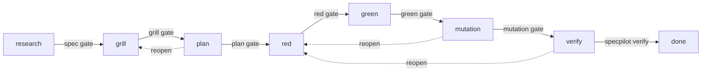

# SpecPilot

**AI coding agents that work from specs, and get tested and measured before you trust them.**

[](https://github.com/OscarRavelo/SpecPilot/actions/workflows/test.yml)
[](LICENSE)
[](package.json)
[](tsconfig.json)

**Status: v0.1 in progress** (target: December 2026). Built in public while learning AI engineering; follow along on X: [@oscarravelo_ai](https://x.com/oscarravelo_ai).

<!-- TODO: add a demo GIF of `specpilot verify` blocking a false "done" (exit 1, hallucination recorded). -->

## Why SpecPilot

AI coding agents are fast, but you can't trust them blindly. Teams adopting spec-driven development with agents keep hitting the same three problems. SpecPilot solves each one:

| Problem | How SpecPilot solves it |
|---|---|
| **Hallucinations with no safety net.** The agent says a task is done when it isn't. | `specpilot verify` reruns the tests, the mutation gate and AC coverage, blocks the false "done" and records it as a hallucination you can measure. |
| **Unknown cost.** No view of what each task costs in tokens and money. | `specpilot cost <task>` reads the Claude Code transcripts and reports the task's tokens per type, cost in USD and EUR, and latency. `specpilot mode standard\|max` switches every agent between a cheaper and a more capable model. |
| **A fragile workflow.** A question or correction mid-task knocks the agent out of the spec-driven flow. | Phase hooks and gates the agent cannot talk its way past keep every step (research, grill-me, plan, red, green, verify) in order. |

**Easy to adopt:** `npx specpilot init` installs the Claude Code hooks, skill and auditor into your project (running it again changes nothing). Then write a spec with Given/When/Then acceptance criteria and let the gates do the checking.

## Key features

- **Specs with testable acceptance criteria**: Given/When/Then per `AC-n`, checked by `specpilot spec lint`.
- **Blocking grill-me**: every checklist item needs a cited source, repo citations are checked mechanically, and a clean-context auditor looks for gaps.
- **Phase hooks**: Claude Code cannot edit tests or code in the wrong phase, and with `--roles` tests and code are written by two different agents.
- **TDD with evidence**: red must fail on an assertion, green must pass with the tests byte for byte unchanged.
- **Tests proven by mutation**: Stryker plus one targeted bug per acceptance criterion; a bug the tests miss sends the task back to red.
- **Cost and latency per task**: tokens, USD/EUR and time from the Claude Code transcripts, plus Standard/Max modes for the agents' model.
- **False "done" detector**: `specpilot verify` reruns everything and records a hallucination when the agent's claim does not hold.

## How it works

SpecPilot is hybrid: the interactive phases run inside Claude Code (`.claude/` skills, subagents and hooks), while checks and metrics run in a Node CLI (`specpilot`, written in TypeScript) that works the same locally and in CI. Every task moves through a strict state machine, and only the CLI can advance it when a phase's gate passes:



- **research → grill**: `spec.md` exists, passes `spec lint` and its `id` matches the folder.
- **grill → plan**: citations check out, no open question, every checklist item and AC is covered, and the auditor found no blockers ([details](docs/grill.md)).
- **plan → red**: not implemented yet in v0.1.
- **red → green**: `red.json` exists and the tests are unchanged since `tdd red`.
- **green → mutation**: `green.json` exists and matches `red.json` and the current tests.
- **mutation → verify**: Stryker ran over the current code, survivors are approved, every AC has a caught bug, and code and tests match green ([details](docs/verify.md#mutation)).
- **verify → done**: only `specpilot verify`, which reruns the checks ([below](#verify-the-false-done-detector)).

Phase hooks block edits the current phase does not allow ([Phase hooks](docs/hooks.md), [Agent roles](docs/roles.md)).

```bash
npx specpilot init                               # install the Claude Code hooks, skill and auditor
npx specpilot spec lint specs/TASK-101/spec.md   # check the spec format
npx specpilot ledger check TASK-101              # check every citation in the grill ledger
npx specpilot grill checklist TASK-101           # show covered and missing checklist items
npx specpilot grill hash TASK-101                # hash the auditor records in audit.md
npx specpilot status                             # show each task's phase
npx specpilot tdd red TASK-101                   # record that the new tests fail on assertions
npx specpilot tdd green TASK-101                 # record that all tests pass, unchanged since red
npx specpilot mutate TASK-101                    # run Stryker over the task's code
npx specpilot mutate bug TASK-101 AC-1           # check that the tests catch a bug injected for AC-1
npx specpilot gate TASK-101                      # close the current phase if its gate passes
npx specpilot verify TASK-101                    # rerun the checks: move to done, or record a hallucination
npx specpilot reopen TASK-101 red                # go back (only plan→grill, mutation→red, verify→red)
npx specpilot cost TASK-101                      # tokens, cost (USD/EUR) and latency of the task; --json for JSON
npx specpilot mode max                           # set every agent's model (standard or max); no argument prints the mode
npx specpilot report                             # one row per task: phase, passed, rounds, hallucinations, cost in EUR
```

## Quickstart

SpecPilot is not published to npm yet. Clone it, install and run the tests:

```bash
git clone https://github.com/OscarRavelo/SpecPilot.git
cd SpecPilot
npm install
npm test            # builds dist/ and runs Jest
```

To use it in your project (React + TS or Node + TS, with Jest), install it from a packed tarball and run `init` at the project root:

```bash
npm pack                                   # in the SpecPilot folder: makes specpilot-<version>.tgz
cd ../your-project
npm i -D ../SpecPilot/specpilot-<version>.tgz
npx specpilot init
```

`init` writes `.claude/settings.json` (the [phase hooks](docs/hooks.md)), the [`sp-grill` skill](templates/.claude/skills/sp-grill/SKILL.md) and the [`grill-auditor` subagent](templates/.claude/agents/grill-auditor.md):

- An existing `settings.json` is merged: your keys and hooks stay first, and only SpecPilot hooks that are missing are added.
- A file you changed is kept and reported (`kept <path> (differs from the template)`).
- A corrupt `settings.json` or `package.json` stops it before any write.
- It warns when Jest, the Stryker packages or `specpilot` itself are missing; it never installs packages.
- Running it again prints `SpecPilot is already installed: nothing changed.`

Each task lives in `specs/<task-id>/spec.md` (start from [`templates/spec.md`](templates/spec.md)). The `id` must match the folder name, and `type` is one of `new-endpoint`, `endpoint-fields`, `react-component` or `cli-command`. Acceptance criteria are `### AC-<n>: <title>` with `- Given` / `- When` / `- Then` steps (`- And` continues the previous step):

```markdown
---
id: TASK-102
type: endpoint-fields
---
# Update phone number on PUT /users/:id

## Acceptance criteria

### AC-1: Sets a phone number on a user that had none
- Given a user with id 42 exists
- And their phone_number is null
- When I send PUT /users/42 with body {"phone_number": "+34623234321"}
- Then the response status is 200
- And the user with id 42 has phone_number "+34623234321"
```

```bash
npx specpilot spec lint specs/TASK-102/spec.md
npx specpilot status
```

## Ground rules

1. **Acceptance criteria must be well written:** each AC is testable, with a clear Given/When/Then and concrete values. If it can't be tested, it's badly written.
2. **A human reviews the tests written from the ACs (human in the loop):** SpecPilot checks the evidence (each AC has a passing test that caught a real bug), but only a person can confirm a test really checks what its AC says.

Following both rules plus SpecPilot's gates is what makes the result trustworthy.

## Verify: the false "done" detector

**`specpilot verify <task>`** is the only way from `verify` to `done`. Instead of trusting the agent's claim, it reruns:

1. the `mutation` gate (code and tests byte for byte green, Stryker evidence fresh, survivors approved, a caught bug per AC);
2. a fresh `npm test`, where every suite must run and every test pass;
3. AC coverage: each `AC-n` needs at least one **passing** test with `AC-n` as a whole id in its name.

| Exit code | Meaning |
|---|---|
| `0` | Everything holds: one `✓ AC-n (k tests)` line per criterion, the task moves to `done`. |
| `1` | Blocked: the agent claimed done when it was not. The reasons are appended as a hallucination to `specs/<task>/hallucinations.json` and the task stays in `verify` (`Go back with specpilot reopen <task> red`). |
| `2` | Cannot run (wrong usage, wrong phase, corrupt or unreadable files, no Jest report, or `hallucinations.json` cannot be written): one line, nothing recorded. |

Full behaviour: [docs/verify.md](docs/verify.md).

## Who it's for

Developers on multi-person teams in large companies, where work arrives as small, concrete tasks like "create an endpoint" or "add these fields to an existing endpoint", often in old, messy codebases.

Stack assumed in target projects: **React + TypeScript** front end, **Node + TypeScript** back end, **Jest** tests (versions depend on the project).

## Roadmap

v0.1 scope (target: December 2026):

- Take a small task described in a spec and run a coding agent on it.
- **Verify** the result against the spec with tests, and flag claims of "done" that don't hold up.
- **Measure** the cost and latency of every task.
- Encourage the agent to **ask for context** when it's unsure, instead of guessing.
- **Two cost modes:** *Standard* minimizes token usage to fit a typical ~$30/month dev plan; *Max* uses the most powerful model when there's no token limit.

Every step is built with rule #1 on SpecPilot itself: tests first, then code, then injected bugs that the tests must catch.

| # | Step | Status | How it is checked |
|---|---|---|---|
| 0 | Project setup: TypeScript, Jest, CLI skeleton, CI | ✅ Done | Type check and `npm test` green on Node >=22 (CI: 22 and 24); `specpilot --help` lists the commands |
| 1 | Spec format and `spec lint` | ✅ Done | Valid and invalid fixtures give exact error codes and line numbers |
| 2 | Task state machine: `status`, `gate`, `reopen` | ✅ Done | Every illegal phase move is rejected; state persists in `state.json` |
| 3 | Grill ledger and citation checker: `ledger check` | ✅ Done | A real citation passes; a missing file, wrong line or altered snippet fails |
| 4 | Grill-me skill, checklist and auditor subagent | ✅ Done | A spec with a planted ambiguity cannot leave the grill phase; a stale or blocked audit fails the gate |
| 5 | Phase hooks in Claude Code | ✅ Done | Editing code before the red phase is blocked |
| 6 | `tdd red` / `tdd green` with evidence | ✅ Done | Red must fail on an assertion; tests cannot change after green |
| 7 | `mutate`: Stryker plus targeted bugs | ✅ Done | A weak test fails the gate; a leftover bug is detected; a bug that does not compile is not counted as caught |
| 8 | `verify` and the false "done" detector | ✅ Done | A criterion with no test blocks the task and counts as a hallucination |
| 9 | Cost and latency metrics, Standard/Max modes | ✅ Done | A known transcript gives exact tokens and € |
| 10 | `specpilot init` (zero friction) | ✅ Done | Installs into sample React + TS and Node + TS projects; running it twice changes nothing |
| 11 | `specpilot report` in the user's project | ✅ Done | Run from the project that uses SpecPilot, it summarizes that repo's own task data (`specs/`, hallucinations, cost) and never reads SpecPilot's repo |

Out of scope (for now):

- Keeping the agent on track when the user interrupts mid-task.
- Multi-agent orchestration, UI polish, and supporting every framework.

Later (parked ideas):

- **v0.2 goal: Azure DevOps integration.** After a couple of setup questions, read work items, draft the spec from the PO's acceptance criteria, detect the Node version (front and back), and generate the best tests for that version.
- Recovering the spec-driven flow after a mid-task interruption.
- A GitHub Action that blocks PRs that fail the evals.
- An MCP server for spec-driven development.

## Development

SpecPilot is written in TypeScript (`src/`) and compiled to `dist/`. It is built with two Claude Code subagents, `tests-agent` (edits only `test/`) and `code-agent` (edits only `src/`), enforced by the repo's own role hook ([Agent roles](docs/roles.md#how-specpilot-itself-uses-roles)). Tests use Jest with ts-jest; the CLI tests run the compiled binary, so they check exactly what gets published.

Requires Node >= 22 (Stryker 10 needs it; `specpilot mutate` stops with a clear message on an older Node). [CI](.github/workflows/test.yml) runs the type check and `npm test` on Node 22 and 24. The suite currently has 1348 tests in 22 suites.

```bash
npm install
npm run typecheck   # tsc over src/ and test/
npm test            # builds dist/ and runs Jest
```

## Documentation

- [Spec format and the grill-me phase](docs/grill.md): ledger syntax, citation checks, checklists, the grill gate.
- [Phase hooks](docs/hooks.md): what each phase blocks, protected files, Bash detection, the stop hook.
- [Agent roles](docs/roles.md): `--roles` and the Bash allowlist for `tests-agent` and `code-agent`.
- [Red, green, mutation and verify](docs/verify.md): evidence files, `mutate`, `mutate bug`, `equivalents.md`, the full `verify` behaviour.
- [Cost, latency and modes](docs/cost.md): how `cost` finds a task's messages, `prices.json`, rounding, and `mode`.
- [Known limits](docs/known-limits.md): every known limit of v0.1, by feature.

## Contributing

See [CONTRIBUTING.md](CONTRIBUTING.md).

## License

[MIT](LICENSE) © 2026 Oscar Ravelo
